<div align="center">

<a href="https://mohamedfarouk.site">
  
</a>

<br />

<a href="https://mohamedfarouk.site"></a>&nbsp;
<a href="https://www.linkedin.com/in/mohamed-elweza/"></a>&nbsp;
<a href="mailto:mohamed.farouk1702@gmail.com"></a>&nbsp;
<a href="https://www.upwork.com/freelancers/~01a9ebd79d9538eae8"></a>&nbsp;
<a href="https://mohamedfarouk.site/Mohamed_Ahmed_Farouk_DevOps_Engineer.pdf"></a>

</div>

<br />

## `$ cat engineer.yaml`

```yaml
name: Mohamed Ahmed Farouk
role: DevOps Engineer @ Contellect Technologies   # Cairo, Egypt
what_i_do:
  - Run cloud-native microservices on Azure AKS, managed as code (Terraform · Helm · Helmfile)
  - Build CI/CD with no manual steps: Jenkins → Docker → Helm → AKS   # −45% release time
  - Make production observable: Prometheus · Grafana · Loki · Tempo
  - Build AI agents for operations: LangGraph + MCP, with a human approving every risky step
certified: [CKA, AWS Solutions Architect – Associate, Azure Administrator AZ-104]
currently_building: DevOps Agent Hub
open_to: DevOps, cloud and platform roles · freelance infrastructure or AI-agent work
```

## 🧰 Stack


## 💼 `git log --career`

> **DevOps Engineer** · Contellect Technologies · *Sep 2025 – Present*
> - Operate microservices on **Azure AKS**; clusters, releases and config managed as code with **Terraform, Helm and Helmfile** across dev, staging and production.
> - Built the **Jenkins CI/CD** that builds Docker images and deploys to AKS through Helm, with no manual steps left (**−45% release time**).
> - Implemented **Prometheus and Grafana** monitoring and alerting; run HA Keycloak, Camunda, PostgreSQL, MongoDB, Redis, Elasticsearch and Nginx.

> **DevOps Engineer** · Freelance · *Nov 2024 – Sep 2025*
> - Deployed a production-ready full-stack app on **Kubernetes** with a MySQL StatefulSet, Secrets, Nginx Ingress with TLS and automated DNS.

> **Junior DevOps Engineer** · Senior Steps · *Jun 2024 – Nov 2024*
> - Took a multi-tier system from on-prem (Vagrant, Ansible) to **AWS**, then containerised it and rolled it out with **ArgoCD and Kubernetes** (GitOps), monitored with Prometheus and Grafana.

## 🤖 Flagship

<a href="https://mohamedfarouk.site/work">
  
</a>

## 🚀 Built, shipped, running in production

<table>
  <tr>
    <td width="50%" valign="top">
      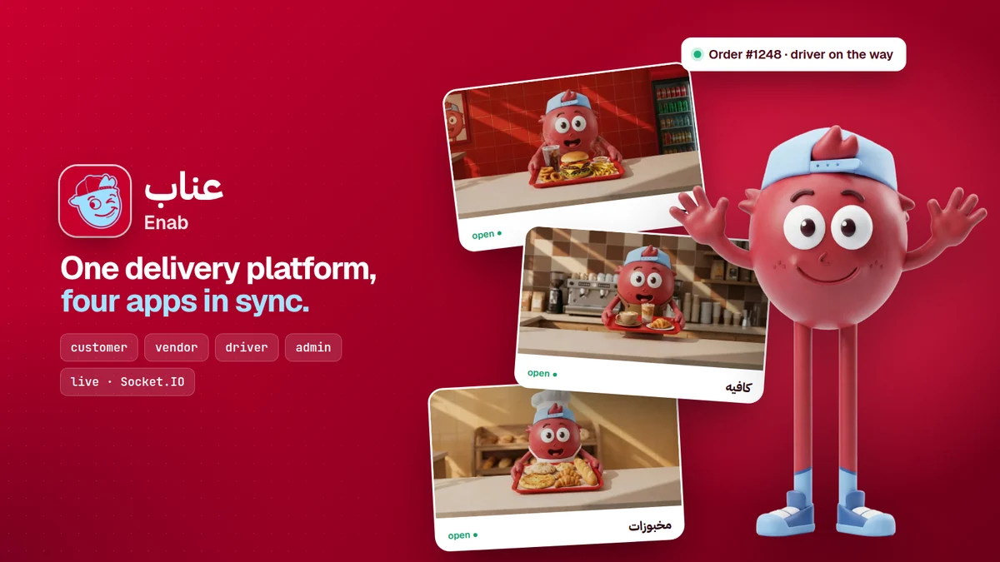
      <h3>Enab · عناب</h3>
      <sub><b>delivery platform · live</b> · 4 apps, 2 dashboards, 1 backend</sub>
      <p>Customer, vendor, driver and admin apps in <b>Flutter</b>, a <b>Node/Express + MongoDB</b> backend and <b>React</b> dashboards. <b>Socket.IO</b> keeps every side of an order in sync live.</p>
      <a href="https://play.google.com/store/apps/details?id=com.elragolel3nab.delivery">▶ Google Play</a> ·
      <a href="https://apps.apple.com/us/app/%D8%A7%D9%84%D8%B1%D8%AC%D9%84-%D8%A7%D9%84%D8%B9%D9%86%D8%A7%D8%A8/id6754914358"> App Store</a>
    </td>
    <td width="50%" valign="top">
      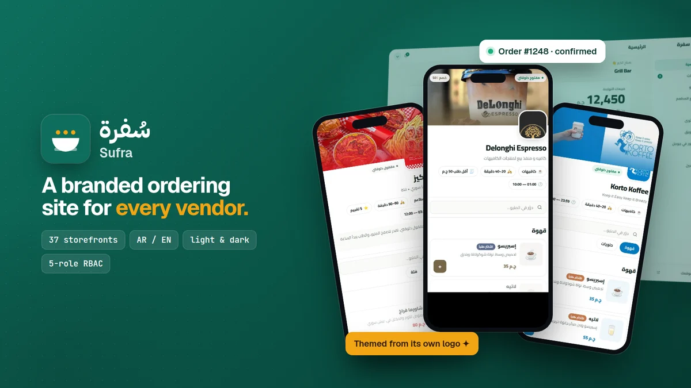
      <h3>Sufra · Multi-Tenant Storefronts</h3>
      <sub><b>AI-assisted delivery</b> · shipped in 9 days by directing AI coding agents</sub>
      <p>37 branded storefronts generated from real marketplace data, in Arabic and English, light and dark. Five-role RBAC, server-side pricing, eight verification suites and two security reviews. <b>Next.js 16 · React 19 · TypeScript</b></p>
    </td>
  </tr>
</table>

## 🏗️ Infrastructure & DevOps projects

<table>
  <tr>
    <td width="33%" valign="top">
      <a href="https://github.com/MohamedElweza/Deploying-a-Highly-Available-Web-Application-with-Terraform">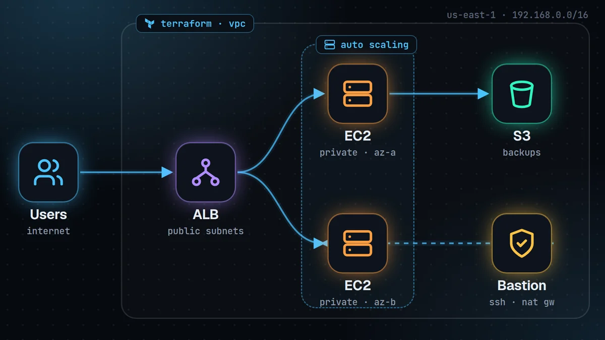</a>
      <b>HA Web App on AWS with Terraform</b><br />
      <sub>Public/private subnets, ALB, auto scaling, NAT, bastion, IAM and S3 backups, all in code.</sub>
    </td>
    <td width="33%" valign="top">
      <a href="https://github.com/MohamedElweza/CI-CD-with-Jenkins-ArgoCD-for-Kubernetes-Deployment">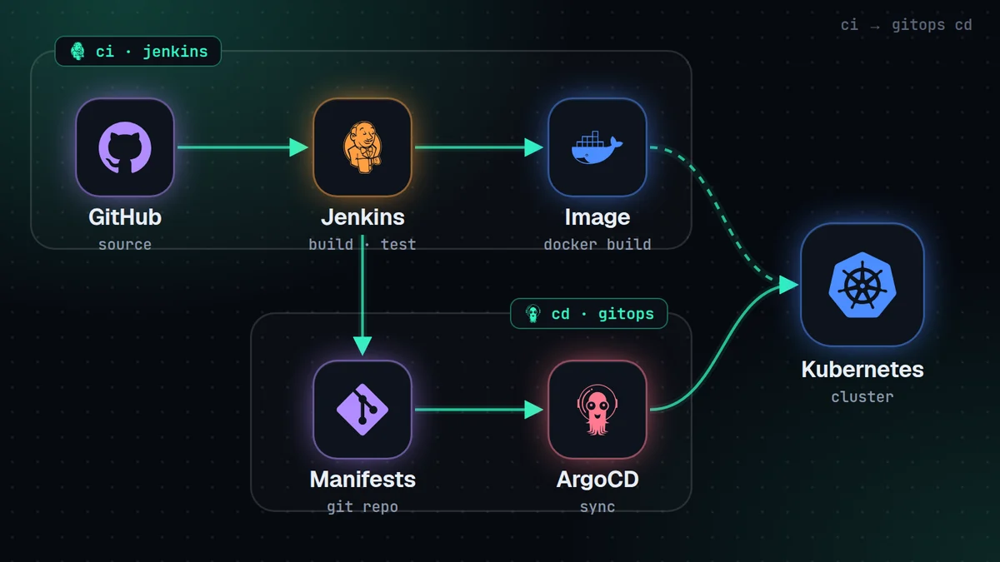</a>
      <b>CI/CD with Jenkins & ArgoCD</b><br />
      <sub>Automated build, test and GitOps sync of a multi-tier Java app onto Kubernetes.</sub>
    </td>
    <td width="33%" valign="top">
      <a href="https://github.com/MohamedElweza/Kubernetes-Deployment-for-Weather-Application">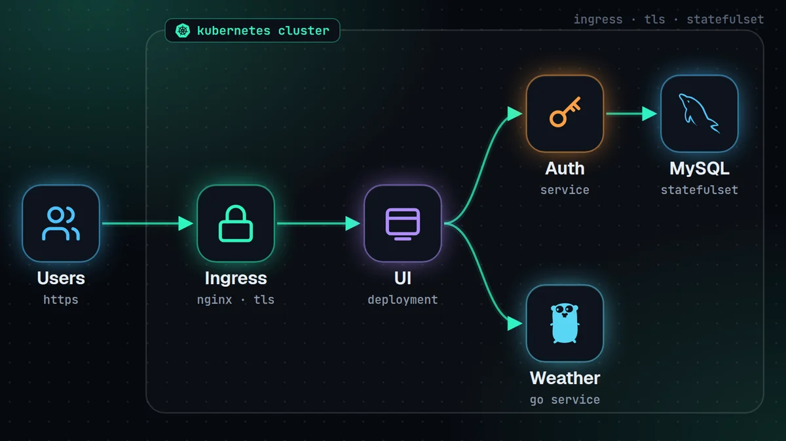</a>
      <b>Kubernetes Microservices</b><br />
      <sub>Secrets, ConfigMaps, a MySQL StatefulSet, Ingress with TLS and init jobs.</sub>
    </td>
  </tr>
  <tr>
    <td width="33%" valign="top">
      <a href="https://github.com/MohamedElweza/Deploying-a-Multi-Tier-Java-Web-Application-on-AWS-Cloud">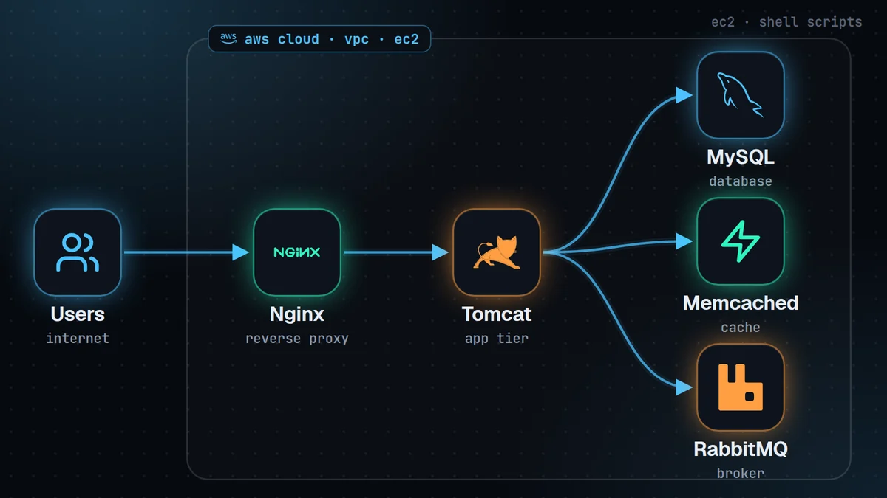</a>
      <b>Multi-Tier Java App on AWS</b><br />
      <sub>On-prem stack re-platformed onto EC2 inside a VPC, automated with shell scripts.</sub>
    </td>
    <td width="33%" valign="top">
      <a href="https://github.com/MohamedElweza/Automating-Multi-Tier-Java-Web-Application-Deployment-with-Ansible">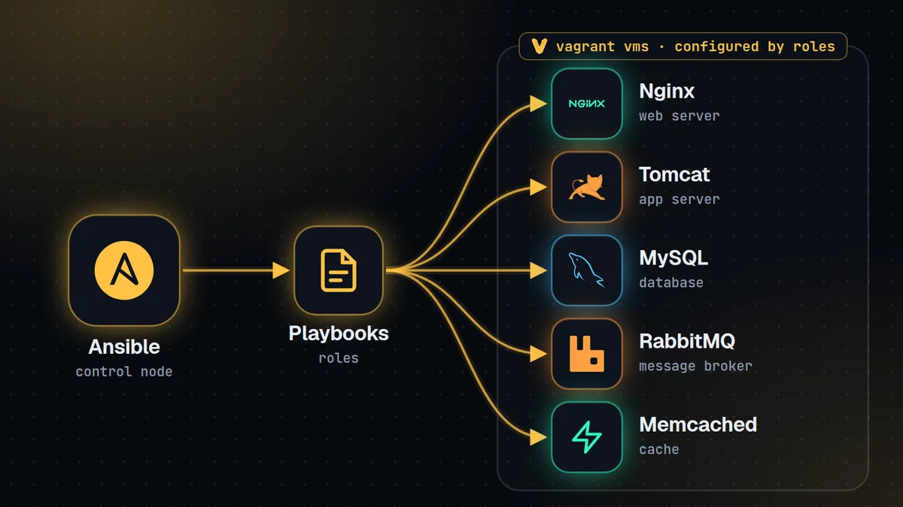</a>
      <b>Ansible: Multi-Tier Deployment</b><br />
      <sub>One Vagrant VM per service, configured end to end by reusable playbooks and roles.</sub>
    </td>
    <td width="33%" valign="top">
      <a href="https://github.com/MohamedElweza/Dockerize-Java-App">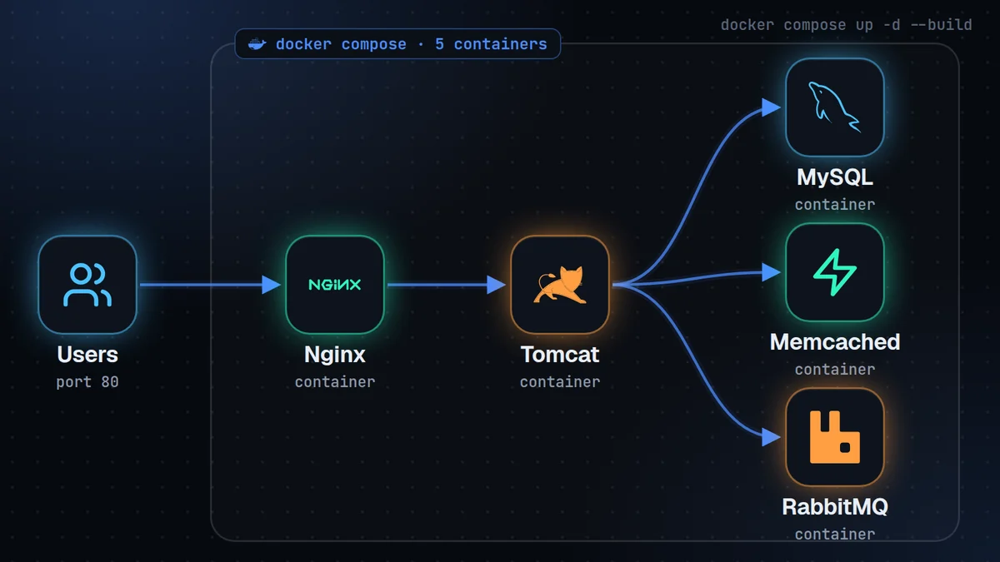</a>
      <b>Dockerize a Java Web App</b><br />
      <sub>Each tier in its own container, orchestrated with Docker Compose.</sub>
    </td>
  </tr>
</table>

## 📱 Apps in the stores

<table>
  <tr>
    <td width="25%" valign="top">
      <a href="https://play.google.com/store/apps/details?id=com.yallashoghl.app&hl=en">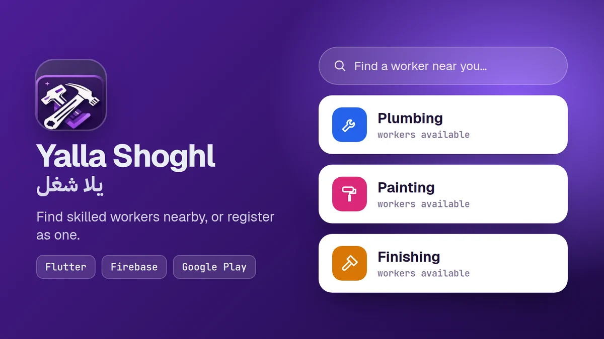</a>
      <b>Yalla Shoghl</b><br /><sub>Marketplace for hiring skilled workers.</sub>
    </td>
    <td width="25%" valign="top">
      <a href="https://apps.apple.com/eg/app/shaklah/id6477922336">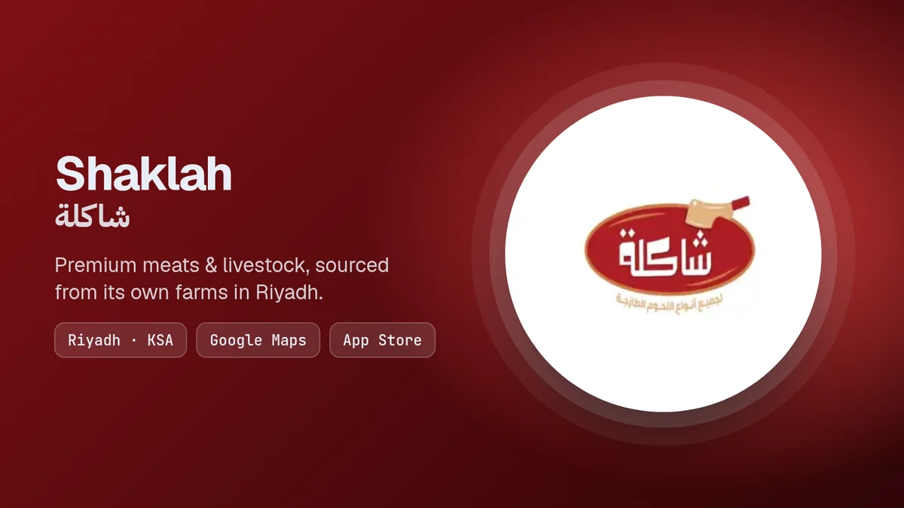</a>
      <b>Shaklah</b><br /><sub>Premium meat and livestock ordering, Riyadh.</sub>
    </td>
    <td width="25%" valign="top">
      <a href="https://play.google.com/store/apps/details?id=com.khair.qatrahayat">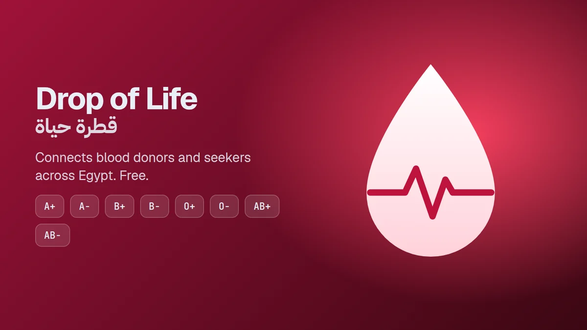</a>
      <b>Drop of Life</b><br /><sub>Connects blood donors and seekers across Egypt.</sub>
    </td>
    <td width="25%" valign="top">
      <a href="https://github.com/MohamedElweza/TouchVision">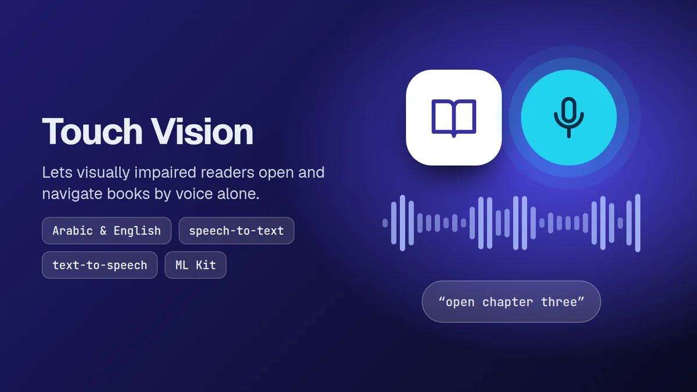</a>
      <b>Touch Vision</b><br /><sub>AI reader that lets visually impaired users navigate books by voice.</sub>
    </td>
  </tr>
</table>

## 🏅 Certifications

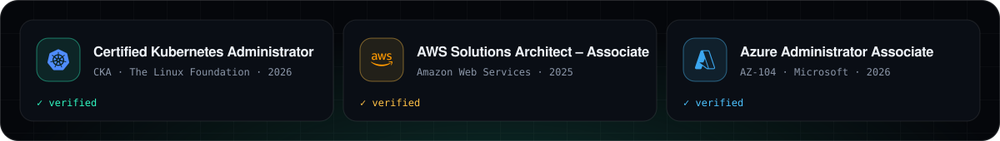

<sub>Also: Red Hat System Administration II (MaharaTech · ITI) · Amazon Cloud Summer Training (NTI) · GCP Cloud Digital Leader (KodeKloud) · Cisco CCNA Summer Training (NTI)</sub>

<br /><br />

<div align="center">
  <a href="https://mohamedfarouk.site">
    
  </a>
</div>
